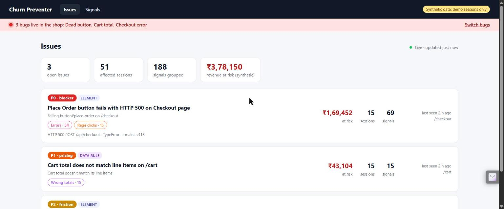
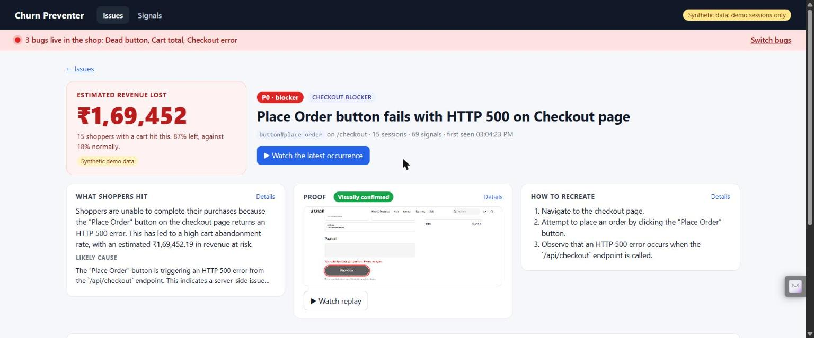

# Churn Preventer Agent

Finds friction and silent data bugs in checkout sessions recorded with rrweb, and ranks them by revenue at risk. Built for the Google Cloud AI Builder Cup 2026 (Retail & Commerce). Full design: [`docs/ARCHITECTURE.md`](docs/ARCHITECTURE.md). Rules for contributors and agents: [`AGENTS.md`](AGENTS.md).

**All demo data is synthetic.** Sessions come from the test kit and the simulator, never from real shoppers.

## Progress (updated 10 Oct 2026)

| Phase | Status | Evidence |
| --- | --- | --- |
| 0. Foundations | Done | Monorepo, schema package, infra and deploy scripts (`pnpm infra:up`, `pnpm deploy:*`), demo shop |
| 1. Vertical slice | Done | `pnpm smoke` passes: SDK to collector to Pub/Sub to processor to signal rows |
| 2. Detectors, clusterer, simulator | Done | `pnpm sim:check`: each injected bug is one issue, precision 100%, recall at least 90%, no clean session in an issue |
| 3. Agents, revenue at risk, ranked findings | Done, running on live Gemini locally | Triage, root cause with a screenshot check, and ranker answered for all three issues with no retries. Scoring is deterministic code |
| 4. Bitemporal, rule author, re-scan | Not built | Finding versions are stored (append-only), but there is no time-travel view, plain-English rule author, or re-scan job yet |
| 5. Deploy and package | Not done | Deploy scripts exist for the collector, processor, clusterer and agent but have not been run against a GCP project by us. API and dashboard are not deployed. No video or deck yet |

Verified locally on 10 Oct: `pnpm build`, `pnpm typecheck` and `pnpm test` (350 tests) pass, and a 40-session `pnpm sim` plus `pnpm sim:check` passes. Nothing has been run on Cloud Run yet.

Recent changes:

- **Issue page redesign.** Revenue lost leads, then three compact cards (what shoppers hit, proof with the visual check, how to recreate). Click a card for the full detail with evidence chips; scoring, evidence, symptoms and the audit trail sit in closed sections.
- **Failed payments are now detected on their own.** `error_correlation` 1.1.0 raises a signal when a click is followed within 2 s by a JS error or a 4xx, 5xx or network failure that no other signal explains. Before, one failed Place Order raised nothing because `rage_click` needs 3 or more clicks.
- **Demo bug switches live in the dashboard.** The top bar shows which of the shop's bugs are live and toggles them; the shop follows within about 2 s. Bug rules: `dead_button` stops after the 3rd press, and `cart_total` fires for any bag of 2 or more items with SAVE10 applied (the same shoe or different ones).
- **Gemini on Vertex AI with an API key.** Keys that start with `AQ.` are Vertex keys, and the AI Studio endpoint refuses them. Set `AGENT_LLM=vertex` (see below).

### Gemini findings in the dashboard (synthetic data, live Gemini)

The issues feed, ranked by revenue at risk:



One finding written by Gemini, with the screenshot the visual check confirmed:



Both screenshots show synthetic sessions from the simulator. The revenue figures come from simulator-set abandonment rates, not real shoppers.

### Run the agents on real Gemini locally

Without a key the agents run a templated offline stand-in. For real Gemini, put one of these in your own `.env` (never commit it):

```text
# AI Studio key
GOOGLE_API_KEY=...

# Vertex AI key (starts with AQ.; AI Studio refuses it with API_KEY_SERVICE_BLOCKED)
GOOGLE_API_KEY=...
AGENT_LLM=vertex
```

Model ids come from `GEMINI_MODEL_BULK` (triage, ranker) and `GEMINI_MODEL_REASONING` (root cause with the screenshot). Which models a key can use depends on its project: ours could use `gemini-3.8-flash` and `gemini-2.5-flash-lite` but not `gemini-3.5-flash-lite`, so `.env` sets `GEMINI_MODEL_BULK=gemini-2.5-flash-lite`. Restart `pnpm dev` after changing `.env`; the agent takes about 40 s to come up.

## What runs today (Phase 3: agents, revenue at risk, ranked findings)

```text
SDK batch ──POST /v1/ingest──> collector ──raw chunk──> Cloud Storage (immutable)
  (rrweb, masking, probes)         └──metadata──> Pub/Sub events.raw (ordering key = session_id)
                                                      └──push──> processor: normalize -> dead_click, rage_click,
                                                                 response_decay, invariant_check, then error_correlation
                                                                   ├──> BigQuery raw_chunks, business_events, signals
                                                                   ├──> Firestore session tail (+ detector state)
                                                                   └──> Pub/Sub signals ──push──> clusterer
                                                                                                    └──> Firestore issues
                                                                                                    └──> agent (:8084, ADK + Gemini): revenue at risk,
                                                                                                         priority tier, triage, screenshot + root cause,
                                                                                                         ranker -> findings: BigQuery (versions) + Firestore
API (:8082) ──> dashboard (:5174): ranked findings, finding pages with evidence-linked analysis, signals, session replay
Logs: pretty in your terminal, structured JSON on Cloud Run -> Cloud Logging, `pnpm logs:tail` back to your terminal.
```

The agent service scores every issue as a finding:

- Revenue at risk is computed in code: affected sessions with a cart × average cart × (abandonment of affected sessions − abandonment of baseline sessions).
- A priority tier comes from a versioned rule set: checkout blocker P0, pricing error P1, bag or checkout friction P2, browse friction P3.
- Three ADK agents explain each finding:
  - triage: summary and repro steps;
  - root cause: checks a screenshot of the masked replay at the flagged moment;
  - ranker: may move the tier by at most one step, citing a rule.

Every claim must cite evidence ids the agents were given. Without `GOOGLE_API_KEY`, an offline stand-in writes templated text so the demo still runs end to end, and the dashboard labels that text as templated.

The clusterer turns many sessions into one issue per broken thing. All the symptoms of one control (dead clicks, rage clicks, "stopped responding", and the errors just before them) share an issue keyed by route and element. Data-rule violations share an issue keyed by rule.

## Requirements

- Node 22 or newer, pnpm 12 (`npm i -g pnpm@12`)
- For GCP only: the [Google Cloud CLI](https://cloud.google.com/sdk/docs/install) (`winget install Google.CloudSDK` on Windows)

## 1. Local mode: no GCP, no keys

```powershell
pnpm install
pnpm dev      # collector :8080, processor :8081, api :8082, clusterer :8083, agent :8084, shop :5173, dashboard :5174; one merged log stream
pnpm smoke    # in a second terminal: sends a synthetic Apply Coupon session, waits for dead_click signals
```

`pnpm smoke` prints `PASS: 2 signal rows within ~1s`. In local mode, `.data/` stands in for GCP:

| GCP service | Local stand-in |
| --- | --- |
| Cloud Storage | `.data/gcs/` (gzipped chunks) |
| Pub/Sub | `.data/pubsub/*.jsonl` plus HTTP push to the processor and clusterer, retried |
| BigQuery | `.data/bq/<table>.jsonl` |
| Firestore | `.data/firestore/` (session tails, markers, issues) |

`pnpm clean` deletes `.data/`. Keep one checkout of the repo: every service reads and writes the `.data/` in that folder, so a second copy running at the same time means a second, separate database.

## See a flagged moment replayed (local, synthetic)

1. Run `pnpm dev`. It starts the collector, processor, clusterer, API, demo shop, and dashboard, with all logs in one stream.
2. Switch a bug on in the dashboard (**http://localhost:5174**, red bar at the top: **Switch bugs**). The bar shows which bugs are live in the shop; the shop follows it within about 2 s. Then open **http://localhost:5173**. This is STRIDE, a fictional sneaker store with synthetic data. (`http://localhost:5173/?bugs=dead_button` still pins bugs for that one tab, and the simulator uses it.)
   1. Accept the banner.
   2. Open a shoe, pick a size, and press **Add to Bag**.
   3. Open the **Bag**, type `SAVE10`, and press **Apply Coupon** 4 or more times, about a second apart. From the 4th press on, the button silently does nothing.
3. Watch the replay in either place:
   - In the shop, open **Demo controls** (bottom left) and press **Watch this session's replay**. This works for any session, flagged or not.
   - Open the dashboard at **http://localhost:5174**. It opens on **Issues**, the live feed, which refreshes every 3 s. Open "Unresponsive button#apply-coupon on /cart" and press **Watch replay** on any occurrence. **Signals** lists every raw detector hit.

   You get a short clip of the shopper's pointer leading up to the flagged press: a blue ring with a trail, and clicks flash. The Apply Coupon button is outlined in red, with a caption saying what went wrong. Flags are red marks on the timeline.
   - The other two bugs (switch them on in the dashboard bar, or with the URL):

     | Bug | URL | What to do | Issue it opens |
     | --- | --- | --- | --- |
     | cart_total | `?bugs=cart_total` | Put 2 or more items in the Bag (two different shoes, or press **+** on one), then apply `SAVE10` | "Cart total doesn't match its line items" (invariant_check) |
     | checkout_error | `?bugs=checkout_error` | At checkout, choose region **Northeast**, then press **Place Order** 3 or 4 times quickly | "Failing button#place-order on /checkout" (rage_click and error_correlation) |
   - The shop's Demo controls panel (replay link only) is tester tooling. It is excluded from recording, so it never appears in replays or triggers detectors.
4. `pnpm e2e` does all of this in a real Chrome (your installed Chrome with a throwaway profile). It checks:
   - the dead clicks, their route and shared fingerprint
   - the replay flags and the red outline
   - that nothing typed at checkout is stored
   - that the session joins exactly one issue

   It saves screenshots to `sim/out/`, including the Issues feed and the issue page.

## Simulate a few hundred shoppers (the Phase 2 exit test, synthetic)

With `pnpm dev` running:

```powershell
pnpm sim -- --sessions 300 --seed 42 --concurrency 8   # about 12 minutes; watch the Issues feed fill in live
pnpm sim:check                                          # scores the issues against the ground truth
```

The simulator drives the shop in real Chrome. It runs a seeded mix: 20% dead_button, 15% cart_total, 15% checkout_error, and 50% clean shoppers. Half of the clean shoppers have a bug flag on but never reach its trigger.

It writes the ground truth to `sim/out/ground-truth.json`, recording for each session its bug, persona, cart value, and whether it ordered or abandoned.

`pnpm sim:check` passes when all of these hold:

- each bug collapses into exactly one issue;
- precision is 100% and recall is at least 90%;
- no clean session is in any issue;
- there are no stray issues.

It also prints abandonment for affected and baseline shoppers, and runs the Phase 3 exit test. Each bug's issue must have a finding with an agent summary and at least two repro steps, and a replay link that opens the flagged moment. It then prints each finding's tier and revenue at risk. Those rates are synthetic by design.

Revenue at risk counts a session once it has been idle for `ABANDON_AFTER_IDLE_MS`, which is 2 minutes in the demo. Run `sim:check` about two minutes after `pnpm sim` ends to see the estimates.

## 2. Your laptop against real GCP: supply the keys

1. Create a GCP project with billing enabled.
2. `copy .env.example .env`, then set:
   - `GCP_PROJECT_ID`: your project id.
   - `GCP_REGION`: default `asia-south1`.
   - `SITE_KEYS`: the SDK keys you accept, e.g. `{"pk_test_demo":"demo"}`.
   - `GOOGLE_API_KEY`: Gemini for the agent service. Without it, the agents run an offline stand-in.
3. Authenticate. Either run `gcloud auth login` and then `gcloud auth application-default login`, or set `GOOGLE_APPLICATION_CREDENTIALS` to a service-account key stored outside the repo.
4. `pnpm infra:up` (add `-- --dry-run` to preview). This creates everything in one region and is safe to re-run:
   - APIs and the Artifact Registry
   - service accounts with least-privilege IAM
   - Firestore with TTL
   - Pub/Sub topics, the ordered `events.raw.processor` subscription and the `signals.clusterer` subscription, both dead-lettered
   - the Firestore index behind the Issues feed
   - a private bucket with 30-day retention
   - the BigQuery dataset, tables and views
   - the `site-keys` and `gemini-api-key` secrets
5. In `.env`, set `CP_MODE=gcp`, `PROCESSOR_PULL=true`, `CLUSTERER_PULL=true`, and `LOG_TO_CLOUD=true`.
6. Run `pnpm dev`, then `pnpm smoke`. The signal rows now land in BigQuery, and the logs appear in your terminal and in the GCP console (log name `cp-local`).

## 3. Deploy to Cloud Run

```powershell
pnpm deploy:collector            # build + test gate, Cloud Build image, Cloud Run (public; site-key auth)
pnpm deploy:processor            # private; switches events.raw.processor to authenticated push
pnpm deploy:clusterer            # private; switches signals.clusterer to authenticated push
pnpm deploy:agent                # private; one always-on instance; Gemini key from Secret Manager; no screenshots (no browser in the image)
pnpm smoke -- --collector https://cp-collector-....run.app
pnpm logs:tail                   # stream the services' Cloud Logging entries into your terminal
pnpm logs:tail -- --service processor --since 1h
```

Each deploy prints a Logs Explorer link. Services scale to zero by default. Use `-- --min 1` on demo day to avoid cold starts.

## Commands

| Command | What it does |
| --- | --- |
| `pnpm install` | Install the workspace |
| `pnpm build` | Compile every package (`tsc -b`) |
| `pnpm typecheck` | Build plus type-check tests and scripts |
| `pnpm test` | All unit tests (Vitest); `pnpm --filter @cp/detectors test` for one package |
| `pnpm dev` | Collector, processor, clusterer, agent, API, demo shop (:5173), and dashboard (:5174), with watch mode and merged logs |
| `pnpm e2e` | Real-browser check: shop -> signals -> one issue -> replay pinpoints the dead click (screenshots in `sim/out/`) |
| `pnpm sim` | Synthetic shoppers with ground truth (`-- --sessions 300 --seed 42 --concurrency 8`) |
| `pnpm sim:check` | Phase 2 and 3 exit tests: scores the issues against the last run's ground truth, then checks each bug's finding |
| `pnpm build:sdk` | Build the one-tag SDK bundle (`apps/sdk/bundle/cp-sdk.js`) |
| `pnpm smoke` | Phase 1 exit test on a synthetic session |
| `pnpm infra:up` | Create or update all GCP resources (`-- --dry-run` to preview) |
| `pnpm deploy:collector`, `deploy:processor`, `deploy:clusterer`, `deploy:agent` | Deploy to Cloud Run (`-- --min 1`, `--skip-tests`, `--dry-run`) |
| `pnpm logs:tail` | Stream Cloud Logging into the terminal (`--service`, `--source cloud_run\|local`, `--since 10m`) |
| `pnpm clean` | Delete local-mode data |

## Privacy

- **Nothing sensitive is stored.** The collector scrubs every batch again before storing it: emails, phone numbers, card-like digit runs, every input `value` (hidden inputs included), typed text, textarea contents, and URL query strings.
- **Probes send numbers, not text.** The cart total, line totals, discount, and quantities are parsed to numbers in the browser; only allowlisted probe selectors are read.
- **Logs carry no payloads.** They hold ids, counts, timings, detectors, fingerprints and selectors only, and a redaction list censors payload keys as a backstop.
- **Gemini sees no raw sessions.** It receives structured evidence only (detector facts, selectors, error signatures, numbers; no session ids, events, or HTML), plus one screenshot rendered from the already-masked replay with the network off.
