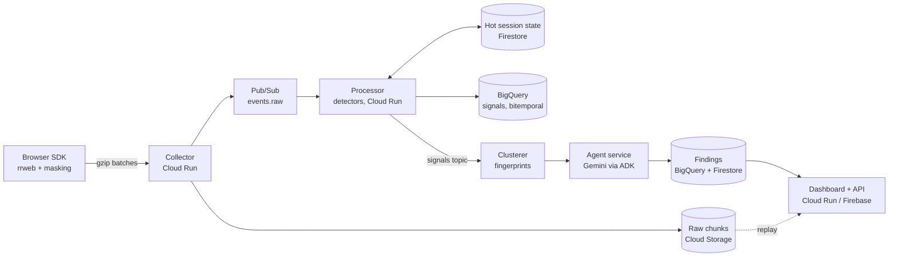

# Churn Preventer Agent: Architecture & Build Plan

Snapshot of the plan written on 23 Sep 2026. From now on this file is the canonical copy for the repo; update it when interfaces, tables, or behavior change. Non-negotiable rules live in `AGENTS.md`.

## 1. Thesis and MVP scope

We build a checkout-focused pipeline that finds friction and silent data bugs in live rrweb sessions, then ranks them by revenue at risk. Frustration tools already flag rage clicks. Our wedge is what they miss: business-rule violations (a cart total that does not match its line items) and retroactive detection (ship a new rule, re-scan the past 30 days).

Working target for the demo: a bug hit in the browser appears as a ranked finding on the dashboard in under 60 seconds. This is a design target, not a measured figure.

In scope for the MVP:

- A browser SDK that wraps rrweb, masks sensitive fields, and ships events in compressed batches.
- A GCP ingest and processing pipeline (Cloud Run, Pub/Sub, Cloud Storage, BigQuery).
- Four pluggable detectors: rage click, dead click, invariant check (cart total vs line items), and JS error or failed-request correlation.
- Cross-session clustering, then Gemini triage and root-cause hypotheses on clusters only.
- A bitemporal findings store with a retroactive re-scan when a rule changes.
- A dashboard with a findings feed, embedded replay, and revenue-at-risk estimates.

Deliberately out of scope: heatmaps, funnels, and general product analytics; mobile SDKs and multi-tenant billing; auto-fixing customer code; self-serve onboarding beyond pasting one script tag.

We target the Retail & Commerce theme and keep every feature tied to the checkout flow.

## 2. System architecture

Raw rrweb data is stored cheaply and never queried directly; a tiered pipeline turns it into signals, clusters, and ranked findings, and only the last tier touches an LLM.



| Component | Responsibility | Scales by |
| --- | --- | --- |
| Browser SDK | Wrap rrweb, mask inputs, detect cheap local triggers, batch and compress, flush with sendBeacon on unload | Client-side sampling |
| Collector (Cloud Run) | Validate site key, assign chunk sequence, write raw chunk to Cloud Storage, publish a small envelope to Pub/Sub | Concurrent requests per instance |
| Pub/Sub (events.raw) | Decouple ingest from processing; ordering key = session_id | Partitioned throughput, backlog buffer |
| Processor (Cloud Run) | Rebuild state per chunk, run every registered detector, emit signals; keep a short session tail in Firestore | Instances subscribed to the topic |
| BigQuery | Append-only signals and findings with event time, ingest time, and rule version | Partition by event date, cluster by tenant and session |
| Clusterer | Group signals across sessions into issues: element symptoms by route and selector, data-rule violations by rule id (section 4) | Push subscription on the signals topic; one transaction per signal |
| Agent service | Gemini triage, root-cause hypothesis, ranking against the rule set, rule authoring | Runs per cluster, not per session |
| Dashboard + API | Findings feed, replay player reading raw chunks, revenue at risk | Static hosting plus a thin API |

Design rules:

- Every stage is idempotent, keyed by session_id and chunk sequence, so Pub/Sub redelivery is harmless.
- Raw data is immutable. Anything derived can be recomputed, which is what makes retroactive re-scan possible.
- The LLM sees structured evidence (signals, selectors, DOM diffs, a few screenshots), never raw rrweb streams.

## 3. Data model

Five append-only tables carry the record: a raw-chunk index, signals, business events, rules, and findings, with two clocks on every row so past states can be reconstructed.

Ingest envelope (one SDK batch; the rrweb events stay opaque to the collector):

```json
{
  "site_key": "pk_live_...",
  "session_id": "s_8f2c...",
  "seq": 42,
  "client_ts_start": 1790000000000,
  "client_ts_end": 1790000004800,
  "client_sent_at": 1790000004900,
  "sdk_version": "0.3.1",
  "release": "git:a1b2c3d",
  "page": { "route": "/checkout", "url_path": "/checkout" },
  "events": [ /* rrweb events: FullSnapshot, IncrementalSnapshot, Meta, Custom */ ],
  "business_events": [ { "name": "cart_viewed", "value_minor": 129900, "currency": "INR" } ]
}
```

The `release` field ties a finding to a deploy. Business events are explicit custom events the site emits (cart viewed, checkout started, order placed); they feed revenue at risk.

Additions implemented in `packages/schema` (25 Sep):

- `sample_rate` (optional, 0 to 1) on the envelope records the SDK sampler's rate, so counts can be re-weighted (AGENTS rule 9). It is stored on `raw_chunks`.
- Each business event may carry `ts` (client epoch ms). It defaults to the batch's `client_ts_end`.
- `session_id` is restricted to `[A-Za-z0-9_-]{8,128}` because it becomes part of storage paths and document ids.
- The collector stores `{v, tenant_id, collector_received_at, envelope}` gzipped at `raw/{tenant}/{session}/{seq:08}.json.gz`. The stored envelope is scrubbed and has no site key. Nothing overwrites it: the write uses `ifGenerationMatch: 0`.
- The `events.raw` message is metadata only: tenant, session, seq, `gcs_uri`, sizes, the three client clocks, `collector_received_at`, release, route, and SDK version. Its ordering key is `session_id`.

| Table | Grain | Key columns |
| --- | --- | --- |
| raw_chunks | One row per stored batch | tenant_id, session_id, seq, gcs_uri, bytes, event_time_start, event_time_end, ingest_time |
| signals | One row per detector hit | signal_id, tenant_id, session_id, detector, detector_version, rule_version, fingerprint, route, element_selector, evidence (JSON), event_time, ingest_time |
| business_events | One row per commerce event | tenant_id, session_id, name, value_minor, currency, event_time, ingest_time |
| rules | One row per rule version | rule_id, version, kind (builtin or generated), definition (JSON), created_by, recorded_at |
| findings | One row per finding version | finding_id, fingerprint, severity, revenue_at_risk_minor, affected_sessions, summary, evidence_refs, rule_version, model_version, valid_from, valid_to, recorded_from, recorded_to |

The two clocks:

- Valid time (`event_time`, `valid_from`, `valid_to`): when it happened in the user's browser, corrected for clock skew by comparing `client_sent_at` with the collector's receive time.
- Transaction time (`ingest_time`, `recorded_from`, `recorded_to`): when our system learned it or wrote that version.

Findings are never updated in place. A change writes a new row, and the previous version is closed. Implementation note: `recorded_to` may be derived in a view with `LEAD(recorded_from)` so the table stays purely append-only; see the `bitemporal-rescan` skill.

As built, column specs live in `packages/schema/src/bigquery.ts`, and a test keeps them in step with the zod row types. Beyond the table above:

- `raw_chunks` also stores `event_count`, `client_sent_at`, `collector_received_at`, `release`, `route`, `sdk_version`, and `sample_rate`.
- `signals` also stores `seq` (the chunk the triggering event arrived in) and `release`.
- Two views exist:
  - `findings_versions` derives `recorded_to` with `LEAD`.
  - `signals_dedup` removes the rare duplicate that streaming insert can leave after a retry. `signal_id` is deterministic and doubles as the streaming insertId.
- Writes use BigQuery streaming insert (`insertAll` with insertIds) behind a `Warehouse` port. The Storage Write API can replace it behind the same port.

Phase 4 additions (15 Oct):

- `signals.rescan_id` (nullable STRING) is set on signals a retroactive re-scan wrote and is absent on live ones. `pnpm infra:up` adds it to an existing table in place.
- `rules` rows for tenant rules are written on approval only: kind `generated`, with the compiled rule, the sentence, the author's model id and prompt hash, and the approver in `definition`. A draft never ran, so it is not part of the record.
- Firestore `rules/{tenant}__{rule_id}` is the hot copy of one tenant rule: the approved version the processor runs, a pending draft with its dry run, and the latest re-scan's progress. The agent service is its only writer.
- (18 Oct) The approved version keeps `origin` (`agent` or `human`, copied from the draft at approval), so the dashboard can show the agent's rules apart from the merchant's. Rules approved earlier have none; the dashboard falls back to the approval feedback (a churn-watcher feature key means the agent).
- `Cluster.found_later` and `Finding.discovery` mark sessions a re-scan surfaced. A finding row's `details` now also carries `kind`, `route`, `anchor`, `cluster_title`, `last_seen` and `discovery`, so an as-of view needs no hot copy.

Planned, not yet implemented: `RuleDraft` (below, section 6) gains `origin: 'human' | 'agent'` and, when agent-originated, the `cluster_id` that triggered it, so a proposal nobody typed a sentence for can still be traced to the issue that produced it.

Live issues (Firestore, implemented 6 Oct). The clusterer keeps one document per issue in `clusters/{tenant}__{cluster_id}`. The document holds the queryable fields `tenant_id`, `cluster_id`, `kind`, `last_seen` and `updated_at`, plus the whole `Cluster` (`packages/schema/src/clusters.ts`) as gzipped JSON:

- symptom counts per detector
- signal and session counts, and up to 5,000 session ids
- releases, fingerprints, error signatures, first and last seen
- the five newest evidence items, one per session where possible

`clustered_signals/{tenant}__{signal_id}` markers, with a TTL on `expires_at` (8 days), make each signal count once under redelivery. Issues are a hot, derived view like the session tail: they are not the bitemporal record and can be rebuilt from `signals` (rule 3). Versioned findings in BigQuery start in Phase 3 and will reference a cluster's fingerprints.

## 4. Detection engine

Detectors are small plugins that read a normalized event stream, not raw rrweb, so rage click detection is one module among several and adding another detector touches no other code.

The processor first converts rrweb events into a normalized stream: clicks (time, target selector, position), DOM mutation counts per target, navigations, inputs, plus custom events from the SDK for network calls, JS errors, and probe values. Every detector implements one interface:

```ts
interface Detector {
  id: string;              // "rage_click"
  version: string;         // bumped on any logic change
  params: Record<string, number | string>;
  run(ctx: SessionContext, chunk: NormalizedChunk): Signal[];
}

interface Signal {
  detector: string;
  fingerprint: string;     // hash(detector, route template, normalized selector, error signature)
  eventTime: number;       // valid time, ms
  evidence: {              // small, structured, replayable
    sessionId: string; seq: number; tStart: number; tEnd: number;
    selector?: string; values?: Record<string, unknown>;
  };
}
```

| Detector | Fires when (starting defaults, to be tuned) | Covers |
| --- | --- | --- |
| rage_click | 3 or more clicks on the same element within 1.5 s and 40 px | Users hammering a broken control |
| dead_click | Click on an interactive element with no DOM mutation, navigation, or request within 800 ms | Controls that do nothing |
| response_decay | An element responded to its first k clicks, then 3 or more consecutive clicks get no response | The button that stops registering after 5 clicks |
| invariant_check | A rule over probe values is violated beyond tolerance (for example cart total differs from the sum of line items by more than 1 minor unit) | Silent data bugs with no user frustration signal |
| error_correlation | A JS error, unhandled rejection, or 4xx/5xx/timeout occurs within 2 s before another signal | Attaches root-cause evidence and raises severity |

These thresholds are our own starting values, not industry standards; expose them as `params` per tenant.

Probes make invariants cheap and re-scannable. A tenant registers probe selectors once (cart total, line-item price, quantity, discount). The SDK emits their text values as custom events whenever the DOM under them changes. Invariants are then pure functions over probe values: no DOM rebuild, and any new rule over already-captured probes can be re-scanned from BigQuery alone. A rule that needs a selector nobody probed goes to the slower rebuild path (section 6).

As built (17 Oct), probes have three sources, all `probe` events: declared in the SDK as above, request probes derived from every finished call, and recorded probes read server-side from a compact mirror of the recorded page, so a selector registered today reads past sessions with no headless browser. See section 6, "the churn watcher".

Fingerprints are what let 400 sessions collapse into one finding. Normalize selectors before hashing: strip generated ids, hashed class names, and positional indexes, and replace dynamic route segments with templates.

Implementation notes (25 Sep):

- **SDK event contract.** Non-DOM facts arrive as rrweb Custom events whose `data.tag` is one of the following (see `packages/schema/src/custom-events.ts`):
  - `cp.net`: phase `start` at the call, and `end` with status and duration. There is no URL query, header, or body.
  - `cp.error`: a normalized signature, never the raw message.
  - `cp.probe`: a snapshot of every registered probe, `{values: {name: number[]}, currency}`, sent whenever any of them changes. Money is parsed to minor units in the browser; the text never leaves it.
  - `cp.nav`: an SPA route change, or `unload` on pagehide before the final flush.

  dead_click needs the `start` phase: without it, a click that triggers a slow request would look dead.
- **DOM index in the session tail.** rrweb clicks reference node ids from an earlier full snapshot. The normalizer therefore carries a compact index across chunks:
  - interactive elements, with their node-local selector and disabled flag
  - aliases from descendants to their nearest interactive ancestor, so a click on a `<span>` inside a `<button>` resolves to the button

  It is rebuilt on each FullSnapshot, updated by mutations, and capped at 5,000 entries.
- **dead_click v1** (`windowMs` 800, inclusive):
  - **Interactive targets:** `button`, `a[href]`, `summary`, submit/button/checkbox/radio inputs, and button-like roles.
  - **Excluded targets:** disabled controls, text inputs, and `select`, which opens native UI with no DOM change.
  - **Responses:** a mutation, navigation, request start, or input change within the window.
  - **Decision horizon:** a click is decided only in the chunk whose horizon (skew-corrected `client_ts_end`) first covers `click.t + windowMs`. The session tail carries the previous horizon, so each click is decided exactly once, even when its response lands in the next batch.
- **Rule versions for builtin detectors.** `rule_version` is a hash of the detector's effective params (defaults merged with tenant overrides from `DETECTOR_PARAMS`), so a threshold change produces new signal versions.
- **Ordering and gaps.** The processor serializes chunks per session. A chunk that arrives ahead of a missing earlier `seq` is nacked for up to `GAP_WAIT_ATTEMPTS` deliveries, then processed anyway so one lost batch cannot stall a session. A chunk at or behind the tail is indexed in `raw_chunks` without detection; re-scan can recover it from raw.

Implementation notes (6 Oct, Phase 2). Every detector below is a pure function in `packages/detectors`, with tests. Thresholds are `params` and can be overridden per tenant through `DETECTOR_PARAMS`.

| Detector (version) | As built |
| --- | --- |
| dead_click (1.3.0) | As above, with the response rule below. |
| rage_click (1.1.0) | 3+ clicks on one element, each within 1.5 s of the previous and 40 px of the first, with 3 inside some 1.5 s window. At least one click must have failed: no response within 800 ms, or an error or failed request within 2 s (`requireFailure`; 0 restores the textbook rule). The burst is decided once its last click + 2 s is covered by a horizon. |
| response_decay (1.1.0) | Per route and selector: 2+ answered clicks, then 3+ unanswered in a row. Fires once per streak. Counts persist across chunks in `SessionTail.detector_state`. |
| invariant_check (1.0.0) | Evaluates each probe snapshot against the tenant's rules (built-in: `cart_total_matches_lines`, cart total = sum of line totals − discount, within 1 minor unit). Reports a given rule once per distinct set of probe values. `rule_version` is `<rule_id>@<version>`. |
| error_correlation (1.1.0) | A second pass over this chunk's other signals. It attaches the latest JS error or failed request in the 2 s before a signal (or during it), inheriting that signal's route and element, so the error lands in the same issue as its symptom. **Standalone (`standalone` 1; 0 turns it off):** a failure that no other signal explains still becomes a signal when a shopper clicked a judgeable control within the 2 s before it, on that control's route and selector. One failed payment is a lost order but too few clicks for rage_click. Only the first such failure per click is reported, in the chunk it arrives in. A failure with no click just before it is ignored. |

- **What counts as a response** (dead_click, rage_click, response_decay; `responseCheck` in `response.ts`): a mutation, navigation, request, or change on the clicked control itself, inside the window and before the user's next click on a different element.
  - Responses after a click elsewhere belong to that click: pressing Checkout right after a dead button navigates, but that does not answer the dead button.
  - A change on another field does not count either. With `sampling.input: 'last'`, rrweb records a text field's change when it loses focus, which is the moment the next button is pressed.
  - The simulator found both false negatives; dead_click went from 1.2.0 to 1.3.0.
- **Two-pass registry.** Primary detectors run first. Correlators (`phase: 'correlate'`) then see the primary signals. A detector that throws is isolated and logged; the others still run.
- **Stateful detectors.** `run` may return `{signals, state}`; the processor stores the state per detector in the session tail and passes it back on the next chunk.
- **Rules** (`InvariantRuleSchema` in `packages/schema/src/rules.ts`) are declarative JSON:
  - `requires`: the probes the rule needs;
  - `assert`: `{left, op: eq | lte | gte, right, tolerance_minor}`, where both sides are expressions over probe values (`probe`, `sum`, `count`, `const`, `add`, `sub`, `mul`, `abs`);
  - optional `routes` and a `highlight_probe` for the replay.

  Tenants add rules through `INVARIANT_RULES`. This is the format the Phase 4 rule author will emit.
- **Issue keys** (the clusterer, `apps/clusterer/src/cluster.ts`): one broken thing produces several symptoms with different per-detector fingerprints, so issues are keyed more coarsely.
  - Element signals: tenant + route + normalized selector.
  - Invariant signals, and errors correlated with them: tenant + rule id.

  A tenant is capped at `MAX_CLUSTERS_PER_TENANT` issues (500); further new issues are refused and logged.

## 5. Agent layer (Gemini + ADK)

Deterministic code decides what is a finding and how much it is worth; Gemini explains it, verifies it visually, and writes new rules. That split keeps rankings reproducible and puts the Gen AI where it adds the most.

Build it with the Agent Development Kit, whose TypeScript 2.0 release has graph workflows that mix deterministic steps and LLM steps, so the whole stack can stay in one language. Deploying is `npx adk deploy cloud_run` with the agent exported as `rootAgent` in `agent.ts`. As of 23 Sep 2026 the GA Gemini models include `gemini-3.8-flash` and the cheaper `gemini-3.5-flash-lite`; model IDs turn over roughly monthly, so read them from config.

| Agent | Model tier | Input | Output |
| --- | --- | --- | --- |
| Triage | flash-lite | Cluster summary: fingerprint, count, route, top selectors, release, 3 to 5 sample evidence items | JSON: title, category, confidence, likely cause, repro steps |
| Root cause and verify | flash (reasoning, vision) | Triage output plus tool calls: session samples, DOM diff at time t, error context, screenshot at time t, release diff | JSON: cause hypothesis, visual confirmation yes or no, evidence ids cited |
| Rule author (built 15 Oct; see section 6) | flash | A merchant sentence such as "cart total must equal line items minus discount plus shipping", plus statistics of the recorded probes | Rule JSON (probes and invariant), a dry run on recent sessions, then human approval |
| Churn analyst (built 17 Oct; see section 6) | flash | One segment the churn watcher's code found (a number, its threshold, both abandonment rates, p-value, a suggested limit), probes on that page, live rules, the merchant's past verdicts and notes | `{propose, churn_reason, title, hypothesis, probe_name, sentence, confidence}`; the sentence goes to the rule author with the proposed probe |
| Rule suggester (built 17 Oct; see section 6) | flash-lite | Same evidence pack as triage and ranker plus probe statistics over the issue's own sessions, for a recurring issue not yet explained by any active rule (a deterministic trigger decides when) | `{propose, sentence, assumptions, explanation}`; the sentence is handed to the rule author, not compiled directly |
| Ranker | Deterministic core with a bounded LLM step | Enriched finding and the priority rule set | Score, tier, and the priority rule ids that applied |

Ranking against a rule set. The priority rule set is versioned data in the `rules` table, for example: checkout and payment blockers outrank pricing errors, pricing errors outrank browse-page friction, and a regression appearing right after a release gets a multiplier. Gemini classifies each finding into these buckets and cites the rule ids. The score itself is computed in code:

```latex
\text{RaR} = N_{\text{affected}} \times \bar{V}_{\text{cart}} \times \left(a_{\text{affected}} - a_{\text{baseline}}\right)
```

N is affected sessions that had a cart, V is their average cart value, and a is the checkout abandonment rate for affected sessions versus a baseline of unaffected sessions on the same route. Using the difference, not the raw abandonment, avoids claiming revenue that would have been lost anyway. The LLM may move a finding by at most one severity tier, and only with a cited rule id.

Grounding and guardrails:

- Every claim in an LLM output must cite evidence ids we supplied; a validator rejects outputs that cite unknown ids.
- Outputs use structured JSON schemas, never free text parsed with regex.
- The visual check is the false-positive filter: render the frame from the replay at the signal time and ask Gemini whether the on-screen state actually shows the defect.
- Each finding stores prompt hash, model id, and rule version so any verdict can be reproduced later.

### Implemented (8 Oct, Phase 3): the agent service

`apps/agent` is a Cloud Run service (local port 8084) that turns issues into versioned, ranked findings. Each pass, per tenant (`AGENT_TENANTS`), it reads the live issues, picks the ones due (new, or not re-scored for `AGENT_RESCORE_MS`; new and biggest first, at most `AGENT_MAX_PER_PASS`), and runs this pipeline (`src/pipeline.ts`):

| Step | Kind | What it does |
| --- | --- | --- |
| Revenue at risk | code (`src/scoring/revenue.ts`) | Formula above, weighted by 1 / `sample_rate`, scaled past the cluster's session-list cap. A session counts once it has been idle `ABANDON_AFTER_IDLE_MS` (ordered or not, so early rates are not biased toward zero). Baseline: unaffected sessions with a cart that visited the issue's route, widened to all routes below `BASELINE_MIN_SESSIONS`. Never negative; `insufficient_data` until `RAR_MIN_AFFECTED` affected sessions have finished. |
| Base tier | code (`src/scoring/priority.ts`) | The most urgent matching rule in the priority rule set (below). |
| Evidence pack | code (`src/evidence.ts`) | E1 issue facts, E2.. up to five signals (detector facts, selector, release, primitive detector values), up to three error signatures, releases, impact numbers; for root cause, the screenshot. No session or signal ids, no node ids, no events, no HTML. |
| Triage | ADK `LlmAgent`, `GEMINI_MODEL_BULK` | Title, category, confidence, summary, likely cause, repro steps. |
| Screenshot | Playwright + rrweb replayer (`src/visual/screenshot.ts`) | Renders the stored, masked replay 600 ms after the flag, flagged element outlined in red, in a sandboxed iframe with the network off. Stored at `screenshots/{tenant}/{cluster}/{signal}.png` (same lifecycle rule as `raw/`). |
| Root cause | ADK `LlmAgent`, `GEMINI_MODEL_REASONING`, image attached | Hypothesis, visual check (`confirmed`, `not_confirmed`, `unclear`, `not_checked`), notes, where to look first. `not_confirmed` marks the finding `suspect` (shown as "Needs review"); it is not dropped. |
| Ranker | ADK `LlmAgent`, `GEMINI_MODEL_BULK` | Cites the priority rules that apply and may propose a one-tier move with a cited rule. |
| Final tier and score | code | The move is applied only if the cited rule is known, cited, and its own tier supports the target. Score = revenue at risk (major units) x tier weight (P0 1, P1 0.75, P2 0.5, P3 0.25) x 1.5 for a release regression. The feed sorts by tier, then score. |

How the agents run (`src/llm/run-agent.ts`): one `LlmAgent` per call with an `outputSchema` (zod, converted by ADK to Gemini structured output), `includeContents: 'none'`, no transfers, temperature 0, and the instruction passed as a function (ADK would otherwise read braces as state placeholders). The evidence is gathered by deterministic code before the call rather than through tool calls, which keeps the inputs auditable and the prompt hash meaningful. Every output passes the zod parse and the grounding validator (`src/grounding.ts`: unknown evidence ids, unknown priority rules, a visual verdict that does not cite the screenshot, a move without a cited rule); a rejected output is retried once with the validator's message, then the step fails closed and the finding keeps its deterministic title, tier and score. Rate limits and transient errors back off exponentially without spending the retry.

Caching: the agents re-run only when the issue's `llm_key` changes: symptoms, error signatures, releases, fingerprints, the session count's power of two (1, 2, 4, 8, ...), the rule set, the models, or `PROMPT_VERSION`. Otherwise the previous analysis and the exact evidence pack it cites are kept, and only the scores are recomputed.

Priority rule set (v1, `DEFAULT_PRIORITY_RULES`, override with `PRIORITY_RULES`): `checkout_blocker` P0 (element on /checkout or /payment with errors), `pricing_error` P1 (any data rule), `checkout_friction` P2 (element on /cart, /bag, /checkout, /payment), `browse_friction` P3 (everything else), `release_regression` (x1.5 when the issue's releases first appeared shortly before it and an older release exists). The service records the rules in the `rules` table (kind `builtin`, `definition.type = priority`) at startup; every finding carries the rule set's content hash.

Without `GOOGLE_API_KEY` (`AGENT_LLM=auto`) both model tiers are an offline stand-in (`src/llm/offline.ts`): an ADK `BaseLlm` that composes grounded, templated answers from the evidence and never claims a visual check. Findings record its model id (`offline-stand-in`), and the dashboard says the text is templated. `AGENT_LLM=vertex` uses Gemini on Vertex AI with application default credentials.

Storage: a finding is one per issue (`finding_id` = `cluster_id`). A new version row goes to the `findings` table only when the version hash changes (analysis, tier, score, status, priority decision, revenue, affected sessions); `valid_from` is the issue's first signal, `recorded_from` the pass time, and `recorded_to` comes from the `findings_versions` view. Phase 3 added nullable columns: `cluster_id`, `title`, `status`, `score`, `input_hash`, `details` (JSON: agent outputs, priority decision, revenue inputs, run log, evidence pack). The latest version also goes to Firestore `findings/{tenant}__{finding_id}` (gzipped payload, index tenant_id + score desc) for the feed.

Triggering: a timer every `AGENT_POLL_MS` (default 5 s), or `POST /run`. On Cloud Run the agent is private, has one instance with CPU always allocated, and skips screenshots by default because the slim image has no browser (`pnpm deploy:agent`; set `AGENT_DEPLOY_VISUAL_CHECK=true` with an image that has Chromium). `src/agent.ts` exports `rootAgent` (the triage agent) for ADK's own tools.

Tests use hand-written fixtures in Gemini's response shape (`apps/agent/test/fixtures`) and the offline stand-in; nothing calls Gemini. They have not been recorded from live Gemini yet, because no key was available when this was built. The screenshot test needs a browser: `CP_BROWSER_TESTS=chrome pnpm --filter @cp/agent test`.

### Implemented (17 Oct): the jury, Undo for rules, Resolved, and the Quality card

**The jury (reports only).** After the triage, root-cause and ranker steps, up to four jurors review the finished report, each in its own call and each blind to the others: the fact checker (does every claim rest on the evidence it cites), the false-alarm hunter, the money-and-priority analyst, and the steps reviewer. Each returns a score from 0 to 1 and a rationale that cites evidence ids (the grounding validator rejects unknown ids). **Code decides**: a report is *approved* when the mean of the jurors who answered is above `JURY_THRESHOLD` (0.66), at least `JURY_SIZE` minus one answered (all of them when fewer than four sit), the three agent steps passed their own checks, and the screenshot did not contradict the report. Otherwise it is *held back* (`status: suspect`, "Needs review"), or *not reviewed* when too few jurors answered (the report is left as it was). The judge only writes the ruling in words; it cannot change the outcome. The verdict (per-juror scores, models, prompt hashes, ruling, the code's own summary line) is stored on the hot copy of the finding as `verdict`, cached by the finding's key, so it is not asked twice and does not make a new version. Settings: `JURY`, `JURY_SIZE`, `JURY_THRESHOLD`. Typed rules are not juried: a person approves them. Code: `apps/agent/src/jury.ts`, `agents/jury.ts`.

**Undo.** `POST /v1/rules/:id/undo` switches an approved rule off. The rule doc's `active` becomes null (the processor stops using it within its rule-cache time), `undone` records the version, who and when, and the `rules` table gets one more row (`definition.type = invariant_undone`); nothing is changed in place and what the rule already found stays as history. Approval itself is unchanged: a person still approves, and the dashboard shows a "Rule is live" notice with an Undo button for 20 seconds, and an Undo button on the live rule card.

**Resolved.** `POST /v1/findings/:id/resolve` and `/reopen` set or clear `resolution` on the finding's hot copy. An issue counts as resolved only while it has not been seen again since (`last_seen <= resolved_at`), so a fix that did not hold reopens by itself. The Issues page leaves resolved issues out of the counts, the revenue total and the "Fix this first" strip, and lists them under Resolved.

**Quality card.** `pnpm sim:check` also writes `.data/quality.json` (bugs planted and found, worst recall, healthy shoppers wrongly flagged, reports the jury approved); the API serves it at `GET /v1/quality` (local mode) and the Issues page shows it. All synthetic.

**Screenshots.** A click detector's frame is now taken at the click, not 600 ms later: shoppers often move on within a second, and a later frame showed another page. A data rule keeps the 600 ms.

## 6. Bitemporal search and retroactive re-scan

Retroactive re-scan is the feature to demo: change or add a rule, re-run it over the past 30 days, and see which users were already hurt, without overwriting what the system believed at the time.

Three kinds of question, each answered by filtering one or both clocks from section 3:

| Question | Filters on | Example |
| --- | --- | --- |
| When did users hit this? | Valid time | Sessions with the coupon bug between 1 and 14 Sep |
| What did we know then? | Transaction time | What the dashboard showed on 15 Sep |
| What did we know then about then? | Both | On 15 Sep, what did we think happened 1 to 14 Sep, versus what we know now |

The third row is the one I did not find any competitor marketing: the gap between the two answers is the bugs the old rules missed.

```sql
-- Findings as we believed them on 15 Sep about events during 1-14 Sep
SELECT finding_id, severity, revenue_at_risk_minor
FROM findings
WHERE valid_from < TIMESTAMP('2026-09-14')
  AND (valid_to IS NULL OR valid_to > TIMESTAMP('2026-09-01'))
  AND recorded_from <= TIMESTAMP('2026-09-15')
  AND (recorded_to IS NULL OR recorded_to > TIMESTAMP('2026-09-15'));
```

Re-scan flow:

1. A rule is created or edited, producing a new row and version in `rules`. A dry run over the last 1,000 sessions shows hit rate and sample hits.
2. A human approves; a Cloud Run Job scans the chosen window, 30 days by default.
3. New signals are written with the new `rule_version`, their original `event_time`, and `ingest_time` = now.
4. The clusterer writes new finding versions and closes the old ones.
5. The dashboard tags each finding as known at the time or found later, with sessions affected since the bug began.

Two execution paths:

- Fast path: rules over signals, probe values, or the normalized event stream. The processor also writes a compact Parquet copy of the normalized stream to Cloud Storage as a derived cache, rebuildable from raw, exposed to BigQuery as an external table. Re-runs take minutes.
- Rebuild path: a rule needing a selector nobody probed. A Cloud Run Job replays raw chunks in headless Chromium using the rrweb replayer and evaluates the new selector. It is slower and costs more, so cap it per run and treat it as phase 2 unless time allows.

Cost guard: partition pruning by event date and a maximum-bytes-billed setting on every re-scan query.

### Implemented (15 Oct, Phase 4): rules in plain English, retroactive re-scan, found later

The fast path is built; the rebuild path (a selector nobody probed) is not.

**Where it runs.** The agent service is the rules service:

- it is the only writer of rule docs;
- it runs the rule author (Gemini), the dry run, the approval record, and the re-scan;
- the API serves reads from the state store and forwards the four actions to it (`AGENT_URL`; on Cloud Run with an ID token from the metadata server).

A re-scan runs in-process in the agent, capped by `RESCAN_MAX_SESSIONS` (newest sessions first) over `RESCAN_WINDOW_DAYS`. `pnpm rescan -- --tenant demo --rule <id>` runs the same code from the command line and is the command a Cloud Run Job would run for larger windows. The job itself is not deployed yet (Phase 5).

**Lifecycle.**

| Step | What happens |
| --- | --- |
| Draft | The sentence and a probe catalog go to the rule author. The catalog holds names, how many snapshots carry each probe, values per snapshot, min, median, max, and routes, built from the newest `RULE_DRY_RUN_SESSIONS` sessions read back from raw. Code compiles the answer and runs the grounding validator. A dry run over the same sessions shows what the draft would flag. The draft lives only on the rule's hot doc. |
| Approve | A person approves a draft by version. Approval writes a `rules` row (kind `generated`, `definition.type = invariant`, with the sentence, model id, prompt hash, dry-run summary, and approver) and starts a re-scan. Editing a rule (a new draft with the same id) makes version n+1. |
| Live | The processor merges the built-in (or `INVARIANT_RULES`) rules with every approved tenant rule from the state store, cached `RULES_CACHE_TTL_MS` (15 s). A store failure keeps the last good list. |
| Re-scan | Lists the window's chunks from `raw_chunks` in one query and loads each from the blob store. Sessions are normalized in seq order with carried state and the processor's skew correction, then the real `invariant_check` runs with the approved rule only. Rows are built by the same `toSignalRows` as the processor. |

**What a re-scan writes.** Signals keep the original `event_time` and get `ingest_time` = the re-scan's time, the rule's `rule_id@version`, and the new nullable `signals.rescan_id`. They go to the warehouse and the `signals` topic, so the clusterer and the agent pipeline treat them like live signals.

**Idempotence.** A hit's `signal_id` is the same whether it was found live, by this re-scan, or by a re-run, so overlap writes and clusters nothing twice.

**Found later.** The clusterer counts sessions that a re-scan signal added to an issue: `Cluster.found_later`, with sessions and per re-scan counts. A session already known from live detection does not count. The finding carries `discovery: {found_later, found_later_sessions, rescan_ids}`. In the record, the issue's first finding version has `recorded_from` after the approval, while its `valid_from` lies before it.

**Rule author** (`apps/agent/src/agents/rule-author.ts`, `GEMINI_MODEL_REASONING`, prompt `r4.1`).

- **Output.** A flat linear form, so Gemini's response schema has no recursion: `left/right: [{coef, kind: probe | sum | count | const, probe, index, value, default_zero}]`, plus op, tolerance, routes, highlight probe, an explanation claim, and assumptions. `understood: false` means the sentence cannot be checked with the recorded probes.
- **Compiling.** Code compiles the form into the detectors' `Expr`. Tolerance stays on `eq` and is folded into the right-hand side for `lte` and `gte`, so detector semantics never change.
- **Validator.** It rejects:
  - unknown probes, routes, or cited ids (S1 is the sentence, P the probes, R the existing rules);
  - a built-in id;
  - a fractional tolerance;
  - anything that does not compile.
  A rejected answer is retried once, then the draft fails closed.
- **Inputs.** The author never sees sessions: only the sentence and probe statistics (numbers, synthetic).
- **Offline.** The offline stand-in understands three sentence families (a per-unit price cap, a discount cap, totals that add up) and says so for anything else.

**As-of queries.** `WarehouseReader.findingsAsOf` is the skill's query over `findings_versions`:

- one row per finding, current at transaction time T;
- valid time overlapping [from, to);
- `maximumBytesBilled` set.

`valid_from` is not constant per finding, because a re-scan can move `first_seen` earlier. The view's window therefore cannot prune on it, and the `valid_from >= since` filter bounds the scan instead.

**Demo.** The demo shop has a fourth, silent bug, `qty_price`. A bag line with quantity 2 or more shows 100x its price (paise shown as rupees), and every total agrees with the shown lines, so no built-in rule fires. Business events and checkout keep the catalog price. The rule "No pair of shoes costs more than ₹17,000, so the bag subtotal must never be more than ₹17,000 times the number of pairs" compiles to `sum(line_total) ≤ 17,00,000 × sum(qty)`. The dearest catalog pair is ₹16,995, so clean sessions never trip it.

**Exit test.** `pnpm sim:rescan` drafts that sentence, approves it, and waits for the re-scan. It then checks:

- one issue holds the bug's sessions (recall at least 90%, precision 100%);
- the issue and its finding are tagged found later;
- time travel as of the approval does not have the finding, now it does, and that finding is the only difference.

### Implemented (17 Oct): agent-suggested rules (a second origination lane)

Before this, a rule existed only because a person typed the sentence; the agent service explained and ranked issues (section 5) but never proposed that one deserves a standing rule. This closes that gap without a second pipeline: one more way a draft gets created, not a second place rules live. The draft, approve, live, re-scan lifecycle above does not change. An agent-originated draft is a draft like any other: same hot doc, same rule author, same dry run, same human approval before it reaches live traffic or a `rules` row.

**Trigger** (code, `shouldSuggestRule` in `apps/agent/src/pipeline.ts`, right after the ranker step of `analyze()`). Deterministic, not scheduled (AGENTS rule 1). An issue qualifies only when all hold:

- at least `RULE_SUGGEST_MIN_SESSIONS` sessions (default 10) over at least `RULE_SUGGEST_MIN_DAYS` between first and last signal (default 0, because demo sessions span minutes; raise to 1 or more in production);
- one consistent symptom: the dominant detector holds at least `RULE_SUGGEST_MIN_DETECTOR_SHARE` of its signals (default 0.5). The route is fixed per issue by the clusterer's key; region is not a recorded dimension;
- not already explained by an active rule: an invariant issue whose anchor is an active rule id (built-in or approved tenant rule) is skipped;
- its revenue at risk is estimated (`status: ok`), so a suggestion always carries a revenue figure.

`RULE_SUGGEST=false` turns the lane off.

**Memory and cost.** The outcome is kept on the finding's hot copy as `rule_suggestion` (`drafted`, `declined`, or `failed`, with the run record). It is not part of the version hash or the BigQuery row, so it never makes a finding version. A `drafted` issue is never suggested again, whatever the merchant does with the draft, and the rule service never lets the agent re-draft a rule id that already has a doc (pending, live, or discarded), so a rejected suggestion does not come back from another issue either. `declined` and `failed` are asked again only when the key changes: the issue's `llm_key` (its nature, or its session count doubling) or the suggester prompt version. So the suggester runs at most once per issue per key, never per signal or per re-score pass. A transient failure (a store read, or the model call itself after its back-off) is not remembered, so the next re-score pass tries again; a step failure never fails the finding.

**Rule suggester** (`apps/agent/src/agents/rule-suggester.ts`, `GEMINI_MODEL_BULK`, prompt `s1`). Input, all structured and numeric (AGENTS rule 2):

- the same evidence pack triage and the ranker receive (E ids), with the triage summary and revenue figures;
- probe statistics over this issue's own sessions (P ids): name, snapshots, values per snapshot, min, median, max, routes, read back from raw for at most `RULE_SUGGEST_MAX_SESSIONS` (default 25) of its sessions, the same kind of catalog the rule author sees;
- the active rules (R ids).

Output: `{propose, sentence, assumptions, explanation}` (`RuleSuggesterOutput`). It proposes only when a recorded number in the issue's sessions is impossible or inconsistent and a rule over the probes would catch it; otherwise it declines with a cited reason. The grounding validator (`validateRuleSuggestion`) rejects unknown ids, a proposal without a sentence or without a P citation, and a decline with a sentence; a rejected answer is retried once, then fails closed. It does not emit a compiled rule: the sentence goes to `ruleService.draft()` and the rule author exactly as a merchant's sentence would, so compiling, validating, and the dry run stay the single code path above.

**Draft record.** `RuleDraft` (`packages/schema/src/rules.ts`) gains `origin: 'human' | 'agent'`, the triggering `cluster_id`, the suggester's run (`suggester`: model, prompt hash, cited explanation), and `revenue_lost`. Drafts stored before 17 Oct have no `origin` and read as human. Two guards apply to agent drafts only: one is refused if that rule id already has a pending draft or a live version (a merchant's draft is never overwritten, and the agent never proposes an edit to a live rule), and one whose dry run flags no session is refused (a rule that flags nothing is noise).

**Revenue lost so far, not just at risk.** Computed once, when the draft and its dry run are made (the dashboard shows the time). For every draft, human or agent, the existing `revenueAtRisk()` (section 5) runs over the dry run's hit sessions instead of an issue's affected sessions: hit sessions with a cart x their average cart x (their abandonment minus the baseline's). The hit set comes from the dry run's own evaluation (an `onHit` callback on `dryRun()`), not a second implementation, so hit count and revenue cannot disagree. Synthetic in the demo.

**Offline.** Without `GOOGLE_API_KEY` the stand-in suggester is a template: it proposes "every line in the bag must hold at least one pair" when an element issue's probe statistics show a bag line with a quantity of 0, and declines otherwise. The offline rule author understands that sentence as a fourth family (`sum(qty) ≥ count(qty)`, rule `bag_lines_have_pairs`).

**Demo.** A fifth synthetic bug, `ghost_line`: pressing Remove on a bag line leaves it in the bag at quantity 0 (shown at ₹0), and Remove then stops responding. Totals agree with the shown lines, so no built-in rule fires, but the dead Remove presses form a live issue on /cart. The suggester sees that issue's sessions record a `qty` of 0 on a bag line and proposes the constant-free rule above, which needs no merchant-only fact (unlike `qty_price`'s ₹17,000 cap). The ghost line is shown at ₹0 on purpose: a charged line with no pairs would also break the merchant's ₹17,000-per-pair rule, and the two demo lanes would catch each other's sessions. The dry run flags the ghost sessions with an estimated revenue lost to date; approving re-scans the past 30 days into a found-later issue. The other demo issues (a dead coupon button, a failing payment) also qualify, but their sessions' numbers are normal, so the suggester declines them.

**Exit test.** `pnpm sim:suggest` (after `pnpm sim`) waits for the agent draft on the ghost_line issue and checks it: origin agent, dry run hits the ghost sessions only, revenue lost estimated; then approves it and checks the re-scan's invariant issue holds the ghost sessions, tagged found later.

**Why one pipeline, not two.** The part with real correctness risk is the compiler, the validator, and the bitemporal re-scan (rules 3 to 5), not where the sentence came from. A second, parallel pipeline risks the two lanes disagreeing on hit rate or revenue, which is exactly the kind of thing a demo gets caught on.

**Risk.** A wrong agent-authored suggestion reads worse than a wrong human one: it looks like the model hallucinated a rule. Hence the conservative trigger, the narrow job (phrasing only, from numbers in the issue's own sessions), the same grounding validator, the zero-hit guard, and a person approving every rule.

### Implemented (17 Oct): the churn watcher, probes read from the recording, and 13 churn bugs

Before this, a finding came from behaviour detectors or from rules over four probes the shop declared in code. Most reasons shoppers leave (a surprise delivery fee, a 9-day delivery estimate, a slow bank, a slow page) break nothing and touch no declared probe, so nothing saw them, and the rule author refused any sentence about them. Three changes close that gap; none touches the SDK.

**1. Probes are any number a session reports** (`packages/schema/src/probes.ts`). All three sources reach detectors as ordinary `probe` events (with a `source`), so rules, the dry run, re-scans, the clusterer and the dashboard need no new rule type:

| Source | What | How it is read |
| --- | --- | --- |
| declared | The SDK probes in site code (cart total, line totals, discount, quantity) | In the browser, as before; only numbers leave it |
| request | Every finished fetch or XHR: `req_<method>_<path>_ms` (duration) and `req_<method>_<path>_status` | By the normalizer from the `cp.net` end events the SDK already sends; a "speed rule" is an ordinary invariant, for example `req_post_api_payment_authorize_ms ≤ 3000` |
| recorded | A name, a CSS selector, a page, and money or count, registered on the Rules tab or proposed by the agent | By the normalizer from a compact mirror of the recorded page (`packages/normalizer/src/mirror.ts`): rrweb's full snapshot and mutations, kept per session in the tail (at most 4,000 nodes, text capped at 80 characters, svg/script/style subtrees opaque). Selectors are a small subset: tag, `#id`, `.class`, `[attr]`, `[attr="v"]`, descendant and `>`. A probe is read once the page has been quiet for 250 ms (as the SDK snapshots), at chunk ends, and only when its value changed |

A recorded probe reads only what the recording already holds, text that was pattern-masked in the browser and scrubbed again at the collector, so registering one collects nothing new from shoppers, and it reads sessions recorded before it existed: re-scans and dry runs normalize from raw with the tenant's registry. The parsers (`parseMoney`, `parseCount`) are shared by the SDK and the normalizer (`@cp/schema/probe-parse`). The processor keeps the mirror for every session (`RECORDED_PROBES`, on by default; the shop is a single-page app, so the mirror cannot wait for a page load) and reads active probes from the registry, cached `PROBES_CACHE_TTL_MS` (15 s).

**Registry.** Firestore `probes/{tenant}__{name}` (`ProbeDoc`: spec, source merchant or agent, status active or disabled, version, approver, preview), written by the agent service only, plus one `rules` table row of kind `probe` per registered version (the bitemporal record). The agent previews a probe over recent sessions before it is saved (sessions with a value, range, samples with replay links), refuses one that reads nothing, refuses names that shadow declared or request probes (`req_` is reserved), and refuses to disable a probe a live rule reads.

**2. The churn watcher** (`apps/agent/src/watch/`). It runs every `WATCH_INTERVAL_MS` (60 s) and on demand (`POST /v1/watch/run`, the dashboard's Look now):

1. **Read** (code). The newest `WATCH_MAX_SESSIONS` sessions of the last `WATCH_WINDOW_DAYS`, from raw, cached by each session's last chunk so a pass reads only what changed. Per session: the largest value of every declared, request and recorded probe, and, in discover mode, of every short number on its recorded pages nobody probes yet ("₹499", "Arrives in 9–12 days"; deepest element, outside controls, with a stable selector).
2. **Contrast** (code, `contrast.ts`). Per number, the threshold where shoppers at or past it abandon their settled cart most often relative to the rest: the baseline is decided cart sessions that reached the same page, not in the segment and not in any issue (rule 9's baseline, like for like). A segment must stand apart (its smallest value at least 1.5x the largest outside it: the watcher hunts defects, a fee that appears or a 6.5 s wait against 0.3 s, not trends such as bigger carts abandoning a little more), hold at least `WATCH_MIN_SEGMENT` sessions against a baseline of at least 12, beat the baseline by `WATCH_MIN_LIFT` (0.3) with a one-sided two-proportion p-value at most `WATCH_MAX_P` (0.01), and not be mostly in an issue already. Two passes, so silent problems do not hide each other: several can hurt shoppers at once (a fee, a slow bank, a slow page), none in an issue, and each would sit in the others' baselines. A loose first pass (half the lift, p at most 0.2) finds every suspicious segment; the final pass judges each number against shoppers no other suspected number explains. Segments of the same shoppers merge (a request's `_ms` and `_status`), preferring a number that is already a probe. Numbers a live rule reads, hypotheses still pending, and numbers a person rejected (unless the gap grew 1.5x) are skipped; an analyst decline is remembered per segment (number, side, threshold), so another segment of the same number can still be raised. A segment waits while more than half as many of its shoppers are still deciding as have decided, because a hypothesis is drafted once. Elements that are already declared probes are never "discovered". Revenue at risk is the existing formula over the segment.
3. **Judge** (Gemini, the churn analyst, `agents/churn-analyst.ts`, `GEMINI_MODEL_REASONING`, prompt `w1`). Input: the candidate (H1: the number, its source, selector and page, threshold, a code-computed `suggested_limit` that separates the segment from everyone else, both abandonment rates, the p-value, revenue at risk), the probes on that page (P), the live rules (R), and the merchant's last 10 verdicts with notes (F). Output (`ChurnAnalystOutput`): propose or not, a churn reason from a fixed list (the reasons shoppers commonly leave), a title, a cited hypothesis, a probe name for a discovered number, and the rule as one sentence naming the probe. The validator rejects unknown ids, a hypothesis that does not cite H1, a bad or taken probe name, and a sentence that does not name its probe.
4. **Draft** (code). The sentence goes to the rule author and dry run like any other (one pipeline), as an agent draft with `cluster_id: null`, the proposed probe (`proposed_probes`) and the hypothesis (`watch`: segment, baseline, lift, p-value, values, up to 500 segment session ids so it can be checked, churn reason, confidence).

**3. People decide, and the agent remembers.** A hypothesis is not a finding: it writes no signal and registers no probe. Approving registers the proposed probe first, then approves the rule as before (live within 15 s, a 30-day re-scan, found later). Not a problem takes an optional note, kept on the rule doc as `feedback` (verdict, note, feature, churn reason, lift); the watcher does not raise that number again unless its gap grows 1.5x, and the analyst reads the notes next time. Change the rule re-drafts from an edited sentence, keeping the proposed probe and the hypothesis. Approvals are feedback too.

**Offline.** The stand-in analyst labels a candidate from words in its name, selector and page (fee, delivery, payment, stock) and writes "The `<probe>` must never be more than `<limit>`", which the offline rule author understands as a fifth family; it declines anything it cannot place (a shoe size, a product count). With `GOOGLE_API_KEY`, Gemini judges.

**Demo: 13 bugs across the churn reasons** (`apps/api/src/demo-bugs.ts`). The synthetic store's backend moved from the shop's dev server into the API (`apps/api/src/demo-store.ts`, local mode or `DEMO_STORE=true`), so a deployed shop has one too. Eight new bugs:

| Bug | Churn reason | What happens | Caught by |
| --- | --- | --- | --- |
| slow_stock | Poor user experience | The stock check behind Add to Bag takes 4 s | The watcher: request probe `req_get_api_stock_ms` |
| shipping_shock | Shipping cost | The bag says delivery is free; checkout adds ₹499 | The watcher: a recorded probe on `#delivery-fee` |
| slow_delivery | Delivery time | The product page says 9–12 days instead of 2–4 | The watcher: a recorded probe on `#delivery-eta` |
| slow_payment | Payment gateway | Authorisation hangs 6.5 s, then the bank times out | The watcher: request probe `req_post_api_payment_authorize_ms` |
| returns_hidden | Returns hassle | The Returns policy button does nothing | dead_click |
| support_down | Customer service | Chat with us fails (503 and a JS error) | error_correlation |
| recs_sold_out | Personalization | Picked for you suggests sold-out shoes; Quick add does nothing | dead_click |
| card_declined | Declined card | Every card is declined; Use another card does nothing | dead_click |

Payment declines and timeouts answer 200 with `ok: false`, so they never merge into checkout_error's element issue. The shop templates its routes (`/product/:id`, `/order/:id`), so a product-page problem is one issue, not one per shoe. Competitor offers and discount-only shoppers are not page defects, and the demo says so.

**Exit test.** `pnpm sim:watch` (after `pnpm sim -- --sessions 240`) waits for the run's carts to settle, asks the watcher to look until each of the four watch bugs has a hypothesis whose segment is that bug's shoppers (precision 100%, recall at least 90%), approves each as the dashboard does, and checks every rule's issue holds the bug's sessions (recall at least 90%, precision 100%), tagged found later.

## 7. Dashboard and API

The dashboard is a ranked findings feed with one click from any finding to the exact replay moment, plus a time-travel control that makes the bitemporal model visible.

Views:

- Overview: revenue at risk over the last 7 days, open findings by tier, sessions ingested, and measured detection latency.
- Findings feed: ranked cards showing title, tier, revenue at risk, affected sessions, first and last seen, release, and a known-at-the-time or found-later tag.
- Finding detail: Gemini summary and repro steps, the visual-verification screenshot, related errors, and evidence items that open the rrweb player at the signal time.
- Rules: detector parameters, the probe registry, and plain-English rule authoring with a dry-run result before activation. As built (17 Oct): "The agent suspects" (the churn watcher's hypotheses: what it saw, why, the proposed probe and rule, the dry run; Approve, Change the rule, Not a problem with a note), Write a rule, Probes (declared, request, recorded; add one with a preview), your rules and the built-ins. A bell in the top bar counts open agent proposals and a toast announces new ones.
- Time travel: an as-of date and a valid-time range that re-query the feed, so a viewer can watch the retroactive re-scan change the picture.

API surface (REST on Cloud Run):

| Endpoint | Purpose |
| --- | --- |
| POST /v1/ingest | Collector; site-key auth, gzip batches |
| GET /v1/findings | List with filters: status, tier, route, release, as_of, valid_from, valid_to |
| GET /v1/findings/{id} | One finding with its version history |
| GET /v1/findings/{id}/evidence | Signals and short-lived signed replay URLs |
| POST /v1/rules | Create a rule version, including plain-English drafts |
| POST /v1/rules/{id}/dry-run | Hit rate and samples over recent sessions |
| POST /v1/rules/{id}/rescan | Start a retroactive re-scan job for a window |

Read path. BigQuery is the source of truth, but it is a poor fit for low-latency UI reads. The agent service also writes the latest version of each finding to Firestore, and the feed subscribes to it for live updates. Time-travel queries go to BigQuery.

Suggested front end: React and Vite on Firebase Hosting, calling the Cloud Run API.

### Implemented so far (25 Sep): signals list and session replay

**Read API (`apps/api`).** Local only for now: it binds to loopback and has no authentication. Phase 3 adds auth and short-lived signed replay URLs before it is deployed.

| Endpoint | Returns |
| --- | --- |
| `GET /v1/signals?tenant=&session=&limit=` | Newest first, deduplicated |
| `GET /v1/sessions/{id}/replay?tenant=` | `{session, events, markers}` |

How the replay payload is built:

- `events` are the session's stored, scrubbed chunks, stitched in seq order.
- Each marker places a signal on the replay's own clock: `replay_ts = evidence.tStart − (collector_received_at − client_sent_at)` of the chunk the event came from. Markers carry `node_id` and `selector`.
- Every BigQuery read filters on `tenant_id` and the partition column and sets `maximumBytesBilled`.
- Replay responses are `no-store`.

**Replay viewer (`apps/dashboard`, React + Vite + rrweb-player).**

| Feature | Behavior |
| --- | --- |
| Pointer | The shopper's pointer is drawn as a blue ring with a fading trail (`mouseTail`); clicks flash rose. |
| Flag markers | Each signal is injected into the event stream as a `cp.flag.<detector>` Custom event. The player's `tags` option draws it as a colored mark on the timeline. |
| Timeline | Network and navigation metadata are dropped from the player's stream; JS errors stay as pink marks. |
| Short clip | Opening a signal plays a short clip (6 s before to 3 s after, via `playRange`). |
| Pinpointing | When playback reaches a flag, the element is found through the replay mirror (`node_id`, falling back to the selector). It is outlined in red, with a caption such as "Dead click on button#apply-coupon: no response within 800 ms". |

**Demo bug switches (local mode only; taken out of the dashboard on 18 Oct, see the next paragraph).** The dashboard's top bar showed which of the shop's three bugs are live and switches them. `GET` and `PUT /v1/demo/bugs` on the API keep the set in `.data/demo-bugs.json`; the routes do not exist in `CP_MODE=gcp`. The shop polls them every 2 s through a Vite proxy, using the `fetch` it took before the SDK wrapped it, so the poll is never recorded and cannot pass for a response to a click. A `?bugs=` in a shop tab (the simulator and e2e send it, even empty) overrides the switch for that tab.

**Dashboard layout and demo bugs (18 Oct).** The bug switches are gone from the dashboard; every shop tab runs the five crucial bugs (`slow_payment`, `checkout_error`, `card_declined`, `cart_total`, `shipping_shock`) plus each other bug with an even chance, never `qty_price` beside `cart_total` (`apps/demo-shop/src/bugs.ts`; list in `docs/DEMO_BUGS.md`). With both payment-authorisation bugs live, the store's backend lets them take turns: the 1st try times out, the 2nd is declined, the 3rd goes through to checkout. Live shop tabs therefore have no clean baseline of their own; the simulator's clean shoppers provide it. The `/v1/demo/bugs` routes remain but nothing calls them. The dashboard is organised for a first glance, with detail one click away:

- **Dashboard** (`#/`): KPI cards that link onward, revenue at risk now over a chart of revenue at risk over time (from the findings record; the live finding continues its history from its last update), Fix these first, revenue at risk by page, the agent's top suggestions, and accuracy.
- **Issues** (`#/issues`): Fix this first with its revenue as the biggest number, then one compact row per issue with priority and page filters. An issue page has a fixed header and Summary, Proof, Sessions and Technical tabs.
- **Rules**: tabs for Waiting for approval, Live rules and Probes; in each, the agent's and the merchant's are separate modules (live rules are filed by `ActiveRule.origin`). Each rule is a compact row; its numbers open with a chevron.
- **Time travel**: revenue at risk over time stacked by issue, with rule approvals, fixes and the chosen moment marked, and a By rule table, above the then-and-now comparison.
- **Signals**: grouped under the issue that clustered them.
- The UI carries no synthetic labels; the writeup and video say the demo data is synthetic (AGENTS.md rule 10).

**Issues feed (implemented 6 Oct).** The dashboard opens on Issues, one card per cluster, most recently active first. It shows:

- the title, kind (element or data rule), and symptom chips with counts;
- the errors seen just before the symptom;
- affected sessions and last seen.

It refreshes every 3 s, and a card flashes when it gains signals. An issue page lists symptoms, errors, releases, the newest occurrences (each opening the replay at its flag), and every affected session.

| Endpoint | Returns |
| --- | --- |
| `GET /v1/clusters?tenant=&limit=` | Issues, newest activity first, without session lists |
| `GET /v1/clusters/{id}?tenant=&sessions=` | One issue with up to `sessions` (default 200, max 5,000) session ids, newest first |

**Findings (implemented 8 Oct, Phase 3).**

| Endpoint | Returns |
| --- | --- |
| `GET /v1/findings?tenant=&limit=` | Latest finding per issue, most urgent tier first, then score, without evidence packs or run logs |
| `GET /v1/findings/{id}?tenant=` | One finding with its evidence pack and agent runs, plus every stored version (`recorded_from`, derived `recorded_to`) |
| `GET /v1/findings/{id}/screenshot?tenant=` | The PNG the visual check used. It is served only from that finding's own `screenshots/{tenant}/{id}/` prefix, with `no-store`. |

The Issues feed is now ranked by finding: a tier badge, the agent's title, revenue at risk, and a "Needs review" flag for suspect findings. A total revenue-at-risk tile is labelled synthetic, and issues not yet scored come last.

The issue page opens with the finding. It shows:

- revenue at risk with the formula filled in;
- the base tier, the rules behind it, and the ranker's reason;
- the summary, repro steps, likely cause, and root-cause hypothesis;
- the visual check with its screenshot;
- the evidence list;
- a reproducibility table (model, prompt hash, attempts, rule set) and the version history.

Each claim carries evidence chips, and signal and screenshot chips open the replay at that moment. Offline stand-in output is labelled as templated.

`pnpm sim:check` also runs the Phase 3 exit test. Each bug's issue must have a finding with an agent summary and at least two repro steps, and a signal evidence item whose replay contains that flag.

Replay captions now cover every detector, for example "Rage clicks on button#place-order: 5 clicks in 2.2 s, 5 failed" or "Cart total doesn't match its line items: shows ₹9,715.50, expected ₹29,146.50" (from a synthetic sim session). Invariant markers outline the probe element (`[data-cp-probe="cart_total"]`).

**Rules and time travel (implemented 15 Oct, Phase 4).** Routes as built (the table at the top of this section was the plan):

| Endpoint | Returns |
| --- | --- |
| `GET /v1/rules?tenant=` | Tenant rule docs (approved version, pending draft with its dry run, latest re-scan), each version as one readable line, plus the built-in rules |
| `GET /v1/rules/{id}?tenant=` | One rule doc |
| `POST /v1/rules/draft` `{sentence}` | Forwarded to the agent: rule author and dry run; 422 when the sentence cannot be expressed |
| `POST /v1/rules/{id}/approve` `{version}` | Forwarded: records the version and starts the re-scan; 409 for a stale version or a re-scan still running |
| `POST /v1/rules/{id}/reject`, `/rescan` | Forwarded: drop the draft; re-scan with the approved version again |
| `GET /v1/history?tenant=&as_of=&from=&to=` | `then` (as of T) and `current` (now) for the same valid-time window, `found_later` ids, and slider `moments` (approvals, finished re-scans), all from the findings record |

The approver is recorded as `dashboard` until the API has sign-in (Phase 5).

- **Rules page.** A sentence box with example chips. A draft shows:
  - the readable rule;
  - the author's explanation and model, with the offline stand-in named as such;
  - the dry run (sessions checked, applicable, flagged, hit rate, already in an issue) with sample replays.

  Approving shows the re-scan's progress, and a link to the resulting issue.
- **Suggested by the agent (17 Oct).** Drafts the rule suggester created (section 6) sit in their own panel, separate from the sentence box, with the same Approve and Discard actions. Each card also shows why the agent suggested it (its cited explanation), a link to the issue that prompted it, and the estimated revenue lost to date over the sessions the dry run flags (synthetic). Every draft, human or agent, shows that figure.
- **Time travel page.** An as-of slider with ticks at approvals and re-scans, and a valid-time stretch (24 h, 7 d or 30 d before T). It shows "What we knew then" next to "What we know now about the same stretch", with found-later issues highlighted and synthetic totals.
- **Issue cards and the issue page.** They show "Found later · N sessions" for issues a re-scan added sessions to.

**Route per click.** A batch can span a navigation, so the normalizer tracks the current route (Meta loads and `cp.nav`) and stamps it on each click. dead_click (v1.2.0) fingerprints on the click's own route, not the route of the batch that decided it. The e2e check caught this: before the fix, the last clicks before navigating away got a different fingerprint.

## 8. Privacy and security

Treat privacy as an architecture constraint: nothing sensitive should leave the browser, and nothing sensitive should reach Gemini. rrweb's defaults are permissive, so masking has to be configured deliberately.

According to the rrweb guide, `maskAllInputs` defaults to false and only password inputs are masked by default. A GitHub issue against rrweb 2.0.0-alpha.18 also reports hidden inputs escaping `maskAllInputs`, open when checked. Verify against the version you pin, and do not rely on client masking alone.

| Layer | Control | Enforced in |
| --- | --- | --- |
| Capture | `maskAllInputs: true`; `blockSelector` for payment and identity elements; `maskTextSelector` for account, address, and order-confirmation text; `maskInputFn` and `maskTextFn` for pattern masking of emails, phone numbers, and card-like digit runs. As built (`apps/sdk`): every text node passes through the pattern mask, `[data-cp-mask]` text is fully masked, `[data-cp-block]` and `cc-*` fields are blocked, and page-load URLs lose their query and fragment before batching. The one-tag bundle is about 26 KB gzipped, including rrweb record. | Browser SDK |
| Probes | Allowlisted selectors only, values parsed to numbers and currency before leaving the browser; probe text is never sent as text | Browser SDK |
| Recorded probes and discovery | Read server-side from the recording already stored (text pattern-masked in the browser, scrubbed at the collector); nothing new is collected. Only numbers reach rules, the dashboard and Gemini; the churn analyst sees numbers, selectors, page routes and the merchant's own notes, never page text or HTML | Normalizer, agent |
| URLs | Drop query strings and fragments from `url_path` by default | Browser SDK |
| Ingest scrub | Second-pass scrubber over the batch JSON before it is written to Cloud Storage; reject unknown site keys; fail closed on parse errors. As built: every input `value` is masked; text and text-bearing attributes (`aria-label`, `title`, `alt`, ...) are pattern-scrubbed; URLs lose query and fragment. SVG and geometry attributes (`d`, `viewBox`, coordinates, transforms) are exempt from pattern scrubbing: they look like phone numbers to the regex, cannot hold typed input, and scrubbing them broke every icon in replays. | Collector |
| LLM boundary | Gemini receives structured evidence and screenshots rendered from the already-masked replay, never raw HTML | Agent service |
| Tenancy | `tenant_id` on every row; per-tenant Cloud Storage prefix; BigQuery row-level policies or per-tenant authorized views; replay URLs are short-lived signed URLs | Data and API |
| Retention | Lifecycle rule on raw chunks (30 days as a starting default, configurable per tenant); signals and findings carry no page content and can live longer; delete by session_id through the raw_chunks index | Storage |

Region. Keep the Cloud Storage bucket, BigQuery dataset, and Cloud Run services in one region near the tenants, for example asia-south1 or asia-southeast1, so data residency is a config choice rather than a rewrite.

Consent. The SDK should start only after the host site's consent banner allows it. Rules differ by country across JAPAC, so get legal review before any real customer data flows; for the hackathon, run on synthetic sessions from the demo shop only.

## 9. Scaling and cost controls

The architecture scales because volume shrinks at every tier: many sessions become fewer signals, signals become clusters, and only clusters reach the LLM. The order in which things break, and the fix for each:

| Stage | What breaks first | Mitigation |
| --- | --- | --- |
| Browser SDK | Payload size and main-thread cost on heavy pages | Use rrweb `sampling` to throttle mouse-move and scroll, `packFn` compression, periodic checkouts, and a hard cap on batch bytes |
| Collector | Bursts at campaign or sale time | Cloud Run autoscaling with a minimum instance count; body size limit; idempotency on session_id and seq |
| Pub/Sub | Large messages and head-of-line blocking on a hot session | Messages carry the Cloud Storage URI and metadata only, never the events; ordering key is session_id |
| Processor state | Firestore read and write per chunk becomes the bottleneck and the bill | Cache the session tail in memory with a TTL, write only on change, move to Memorystore if needed |
| BigQuery | Many small inserts and full-table scans | Batch through the Storage Write API; partition by event date; cluster by tenant_id and session_id; never query raw chunks from BigQuery |
| Clusterer | Fingerprint cardinality explosion | Selector normalization, a per-tenant cluster cap, and only the top 5 evidence items stored per cluster |
| Agent and LLM | Cost and rate limits | Run per cluster, skip re-triage when a cluster is unchanged for the same release, add backoff, and process top-N first |
| Dashboard | BigQuery latency on live views | Firestore hot copy of the latest finding versions |

Edge sampling with a ring buffer. The SDK keeps the last 30 seconds of events in memory and ships a session only when a local trigger fires (rage or dead click, JS error, failing probe), plus an unbiased baseline sample of ordinary sessions. Do not skip the baseline: revenue at risk in section 5 needs unaffected sessions to compare against, and trigger-only sampling would bias abandonment upward. Record the sampling rate on each session so counts can be re-weighted.

Why the funnel matters for cost. Gemini 3.8 Flash is listed at $0.75 per million input tokens and $3.75 per million output tokens through 31 Dec 2026, rising to $1.50 and $7.50 on 1 Jan 2027. With illustrative assumptions of 6,000 input and 1,000 output tokens per call, triaging 200 clusters a day costs about $1.65. Sending each of 1,000,000 daily sessions through the same call would cost about $4,500 in input tokens alone. Treat both as lower bounds, since the model can spend more tokens on hard tasks.

Beyond one tenant. Give large tenants their own Pub/Sub subscription and Cloud Run concurrency limits, enforce a per-site-key quota, and keep every table keyed by tenant_id so a noisy customer cannot starve the rest. Cloud Logging is the wrong sink for this data: a log entry is capped at 256 KiB and the limit cannot be raised; use it only for our own service logs.

## 10. GCP service map and repository layout

Everything runs on Cloud Run plus managed data services, which satisfies the Cup requirement to use Gemini or Google's agent platforms and to deploy on Cloud Run or Firebase.

| Need | GCP service | Notes |
| --- | --- | --- |
| Collector, processor, clusterer, agent, API | Cloud Run | One service each; the agent deploys with `pnpm deploy:agent` (same image as the others) |
| Event fan-out | Pub/Sub | Topics: events.raw (ordering key = session_id) and signals; subscriptions events.raw.processor and signals.clusterer, each with a dead-letter topic |
| Raw chunks and Parquet cache | Cloud Storage | Per-tenant prefix, lifecycle rule for retention |
| Signals, findings, rules, business events | BigQuery | Partitioned by event date, clustered by tenant_id and session_id |
| Hot session tail, live issues, latest findings | Firestore | Session tail and markers with a TTL; `clusters` behind the live issues feed (composite index tenant_id, last_seen desc); `findings` (composite index tenant_id, score desc) |
| Re-scan and rebuild work | Cloud Run Jobs | As built (Phase 4), the fast-path re-scan runs inside the agent service after an approval, capped per run; `pnpm rescan` is the same code as a job command for larger windows (not deployed yet) |
| Dashboard hosting | Firebase Hosting | React and Vite build |
| API keys and site keys | Secret Manager | Gemini key held here per the ADK Cloud Run docs |
| Our own service logs and alerts | Cloud Logging and Monitoring | Never customer session data |

Gemini can be reached with an AI Studio API key for speed during the hackathon, or through Google's agent platform with service-account auth for a production posture. Both are named as acceptable in the Cup rules; quotas have not been compared.

Monorepo layout: see `AGENTS.md`. The `sim` folder matters as much as any service: it produces the hundreds of realistic sessions that make the dashboard and the retroactive re-scan demonstrable.

Simulator (implemented 6 Oct). `pnpm sim -- --sessions 300 --seed 42 --concurrency 8` drives the demo shop in real Chrome, so the real SDK, probes, collector, processor, and clusterer all run.

- **Plans.** Seeded plans (`sim/src/plan.ts`) give the mix (since 17 Oct, 13 bugs, so run 240+ sessions): 8% dead_button, 7% cart_total, 7% checkout_error, 6% qty_price (abandons 70%), 6% ghost_line (75%), 5% each for slow_stock, shipping_shock, slow_delivery, slow_payment, returns_hidden, support_down, recs_sold_out and card_declined, and about 26% clean. The four watch bugs (`WATCH_BUGS`) and qty_price are silent until a rule exists; `sim:check` accepts that, and `pnpm sim:watch` checks the watcher finds the four. qty_price is a retro bug: `sim:check` accepts it having no issue, and `pnpm sim:rescan` checks the merchant rule surfaces it. ghost_line's issue is live; once its agent-suggested rule is approved, the rule's own issue may also hold its sessions, and `sim:check` accepts that second issue. `pnpm sim:suggest` checks the suggestion end to end.
- **Near misses.** Half of the clean sessions carry a bug flag whose trigger they never reach: at most 2 coupon presses, a discounted bag kept at a single item, a region other than Northeast, quantities kept at 1, or never pressing Remove (only the ghost_line shopper does). A test asserts that affected plans reach their trigger and clean plans never do.
- **Abandonment.** Affected shoppers abandon more often than the baseline by design (dead_button 60%, cart_total 40%, checkout_error 85%, qty_price 70%, ghost_line 75%, against 25%). Every session is recorded (sample rate 1), so the baseline is unbiased.
- **Ground truth.** It goes to `sim/out/ground-truth.json`.
- **Scoring.** `pnpm sim:check` waits for the pipeline to go quiet, then scores the issues against the ground truth: one issue per bug, precision 100%, recall ≥ 90%, no clean session in any issue, no stray issues. It writes `sim/out/check-report.json`.

### Runtime modes, configuration, and logs (implemented 25 Sep)

One switch, `CP_MODE`, selects the adapters behind the ports in `packages/platform`. Every setting is in `.env.example`.

| Port | `local` (default, no credentials) | `gcp` |
| --- | --- | --- |
| Blob store | `.data/gcs/` | Cloud Storage, write-if-absent |
| Publisher | `.data/pubsub/*.jsonl` plus HTTP push in Pub/Sub push format (events.raw to the processor on :8081, signals to the clusterer on :8083), retried, ordered per key | Pub/Sub with message ordering |
| Warehouse | `.data/bq/<table>.jsonl`, deduplicated on insertId | BigQuery streaming insert |
| Session state and issues | `.data/firestore/` (issue updates serialized per issue in process) | Firestore (tail and issues stored as gzipped bytes; TTL on `expires_at`; issue updates in transactions) |

How the processor and clusterer receive messages:

| Where it runs | Intake |
| --- | --- |
| Local mode | HTTP push from the local publisher |
| Cloud Run | Authenticated Pub/Sub push to `/pubsub/push`, set up by `pnpm deploy:processor` and `pnpm deploy:clusterer` |
| A laptop against real GCP, before deploy | Streaming pull (`PROCESSOR_PULL=true`, `CLUSTERER_PULL=true`) |

A poison message is acked and logged; it is not retried. Transient failures return 500 so Pub/Sub retries, and after 10 attempts the message goes to `events.raw.dlq` or `signals.dlq`.

Logs are our own service logs only (rule 8). pino writes them in one of three formats:

| Setting | Output |
| --- | --- |
| Pretty (default locally) | One colored line per event, tagged `[collector]` or `[processor]`. `pnpm dev` merges both services into one terminal. |
| gcp (auto on Cloud Run) | Structured JSON on stdout (`severity`, `message`, `serviceContext`, trace ids), which Cloud Logging and Error Reporting parse with no agent. |
| `LOG_TO_CLOUD=true` | A local run also ships batched entries to Cloud Logging under the log name `cp-local`. |

`pnpm logs:tail` streams both kinds of entry back into the terminal. A redaction list censors payload keys (`events`, `body`, `envelope`, `site_key`, `evidence.values`, and auth headers) as a backstop. The code logs ids, counts, timings, detectors, fingerprints, and selectors only.

`pnpm infra:up` creates the resources in the service map above in one region, idempotently. Data resources are created through the client libraries; APIs, service accounts, IAM, Firestore, Artifact Registry, and secrets through gcloud. `pnpm deploy:<service>` does the rest:

1. Gates on `pnpm build` and `pnpm test`.
2. Builds the root `Dockerfile` with Cloud Build.
3. Deploys to Cloud Run with a per-service service account:
   - the collector is public, since site-key auth protects it;
   - the processor and clusterer are private, invoked only by the Pub/Sub push identity.

## 11. Build plan to submission

The Cup's home page lists the building phase as 7 Sep to 18 Oct 2026, with submission due 18 Oct, so we have 25 days from 23 Sep; build a thin vertical slice first and add depth in layers. Its FAQ says registration closes 4 Oct while the home page says team formation runs to 11 Oct, so register by 4 Oct to be safe. The home page also lists eligibility as ages 21 and over, working professionals, entrepreneurs, and startups, with students ineligible: confirm this applies to the whole team.

| Dates | Phase | Deliverable | Exit test |
| --- | --- | --- | --- |
| 23 to 25 Sep | 0. Foundations | Team registered, GCP project, monorepo, shared schema package, infra scripts for topics, bucket, and datasets, demo shop skeleton with bug flags | `infra` creates everything from scratch in one command |
| 26 Sep to 1 Oct | 1. Vertical slice | SDK to collector to Pub/Sub to processor with one detector (dead_click) to BigQuery to a bare findings list | Clicking the broken button in the demo shop produces a signal row within a minute |
| 2 to 7 Oct | 2. Detector set | rage_click, response_decay, error_correlation, probes and invariant_check; clusterer with fingerprints; Firestore live feed; `sim` generating a few hundred sessions | The three injected bugs each collapse into one cluster |
| 8 to 12 Oct | 3. Agent layer | Triage, visual verification, revenue-at-risk score, priority rule set; finding detail page with replay at the signal moment (built 8 Oct; see section 5) | A finding shows a Gemini summary, repro steps, and a working replay link |
| 13 to 15 Oct | 4. Bitemporal | Versioned findings, time-travel controls, plain-English rule author with dry run, fast-path retroactive re-scan | Adding a rule surfaces past sessions tagged found-later |
| 16 to 17 Oct | 5. Harden and package | Final deploy to Cloud Run and Firebase, 3-minute video, deck, README, public repo cleanup | A fresh browser runs the whole demo with no console errors |
| 18 Oct | Submit | Prototype link, video, public repo, deck | Submitted a day early if possible |

Demo shop bug flags:

- `BUG_DEAD_BUTTON`: the Apply Coupon button silently stops responding after the third click.
- `BUG_CART_TOTAL`: with a discount applied and 2 or more items in the bag (the same shoe or different ones), the cart total leaves out the last item, so it differs from the sum of line items.
- `BUG_CHECKOUT_ERROR`: the payment step throws a JS error and a 500 for one region, producing rage clicks and abandonment.
- `qty_price` (added 15 Oct for Phase 4): a bag line with quantity 2 or more shows 100x its price, and every total agrees with it. No built-in rule sees it; a merchant rule written later finds the sessions it already hurt.
- `ghost_line` (added 17 Oct for agent-suggested rules): Remove leaves a bag line in the bag at quantity 0 (₹0), and then stops responding. The dead presses form a live issue; the rule suggester proposes the rule that catches a bag line with no pairs (section 6).
- Eight churn-reason bugs (added 17 Oct for the churn watcher): `slow_stock`, `shipping_shock`, `slow_delivery`, `slow_payment` (the watcher proposes a probe and rule for each), and `returns_hidden`, `support_down`, `recs_sold_out`, `card_declined` (caught live by detectors). See the table in section 6.

The `sim` generator runs several hundred scripted sessions with randomized behavior, where bug-affected sessions abandon at a higher rate than the rest. Those rates are parameters we choose, so say clearly in the demo and README that the data is synthetic.

Splitting the work (fold tracks together if the team is two people):

- Track A, capture and ingest: SDK, probes, ring buffer, collector, infra.
- Track B, detection: normalizer, detectors, processor, clusterer.
- Track C, intelligence: ADK agents, scoring, rule author, bitemporal queries and re-scan.
- Track D, product and demo: dashboard, demo shop, `sim`, video and deck.

## 12. Demo script and risks

The 3-minute video should spend about a third of its time on the retroactive re-scan, because that is where innovation and technical merit meet. The Cup scores technical merit and Gen AI implementation at 40%, problem alignment and impact at 25%, innovation and creativity at 25%, and user experience at 10%.

| Time | Show | Say | Scores on |
| --- | --- | --- | --- |
| 0:00 to 0:20 | Demo shop cart where the total does not match its lines | Users do not report this; they leave | Problem alignment |
| 0:20 to 0:50 | Click Apply Coupon six times; a quick architecture frame | One script tag streams rrweb sessions through Pub/Sub into our detectors | Technical merit |
| 0:50 to 1:30 | Findings feed: three findings from hundreds of sessions; open one | Clustered, ranked by revenue at risk; Gemini explains it and confirms it visually; jump to the replay moment | Gen AI implementation |
| 1:30 to 2:10 | The toast: "The agent suspects an unexpected ₹499 delivery fee at checkout". Open it: 71% of those shoppers left against 15% (synthetic), a probe nobody wrote, the rule, the dry run; approve. Then type a plain-English rule yourself | The agent watches every session for what makes shoppers leave, finds the number, proposes the probe and rule; a person approves, and the re-scan finds last week's shoppers it already cost | Innovation and Gen AI |
| 2:10 to 2:40 | Move the as-of control | What we believed then versus what we know now | Innovation and UX |
| 2:40 to 2:55 | Funnel counts: sessions, signals, clusters, Gemini calls | The LLM only sees clusters, so cost stays flat as traffic grows | Technical merit and impact |

Record from pre-warmed services and keep a pre-recorded fallback clip.

Top risks:

| Risk | Mitigation or fallback |
| --- | --- |
| Judges say existing session-replay tools already do this | Concede that rage-click detection is common; lead with business-rule invariants and retroactive re-scan, and name the gap plainly |
| The rebuild path (headless replay) consumes the schedule | Keep the demo on the fast path; treat rebuild as phase 2 |
| False positives from detectors | Visual verification, tunable parameters, dry run, and precision measured against sim ground truth |
| Revenue at risk looks made up on synthetic data | State it is synthetic, show the formula, and use the affected-versus-baseline difference |
| Live demo failure from cold starts, quota, or model latency | Minimum instances, cache Gemini output per fingerprint and release, fallback recording |
| Gemini model IDs change or move to preview | Read model IDs from config and pin to GA models |
| Eligibility or registration dates differ from what we assumed | Confirm on the official pages this week and register by 4 Oct |

## Sources

Pages opened while preparing this plan, as of 23 Sep 2026.

- [AI Builder Cup 2026: home, timeline and eligibility](https://aibuildercup.com/)
- [AI Builder Cup 2026: FAQs](https://aibuildercup.com/Faqs.html)
- [AI Builder Cup 2026: themes and judging criteria](https://aibuildercup.com/themes.html)
- [Gemini API: latest model](https://ai.google.dev/gemini-api/docs/latest-model)
- [Gemini API: release notes](https://ai.google.dev/gemini-api/docs/changelog)
- [Agent Development Kit overview](https://adk.dev/)
- [ADK: deploy to Cloud Run](https://adk.dev/deploy/cloud-run/)
- [rrweb guide (record options)](https://github.com/rrweb-io/rrweb/blob/main/guide.md)
- [rrweb issue 1609: hidden inputs not masked](https://github.com/rrweb-io/rrweb/issues/1609)
- [rrweb: best open source session replay tools](https://rrweb.com/blog/best-open-source-session-replay-tools)
- [Cloud Logging quotas and limits](https://docs.cloud.google.com/logging/quotas)
